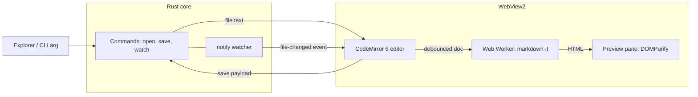

# PRD — Markdown Editor for Windows (Tauri 2 + CodeMirror 6)

Sep 26, 2026 · @Vikas Singh

## Overview

Build a Windows-native Markdown editor that opens in under 500 ms, ships as a sub-10 MB installer and idles under 120 MB total RAM, using Tauri 2 and CodeMirror 6.

**Problem.** Popular Markdown editors on Windows are either Electron apps (150–300 MB RAM, 80–150 MB installers) or bare text editors with no live preview. Opening a single README should not cost the memory of a browser.

**Vision.** A focused, keyboard-first editor: open a `.md` file, edit with syntax highlighting, see a live preview, save. Nothing else competes for resources.

**Approach.** Tauri 2 reuses the WebView2 runtime already present on Windows 10/11, so no browser engine ships in the installer. A thin Rust core owns file I/O; a lightweight TypeScript frontend hosts CodeMirror 6 for editing and markdown-it for preview.

## Goals, non-goals and success metrics

v1.0 succeeds when every performance budget below holds on a mid-range Windows 11 laptop (4-core CPU, 8 GB RAM, SSD).

**Goals**

- Fast, reliable read/edit/save of Markdown files on Windows 10 (22H2) and Windows 11.
- Live side-by-side preview that never blocks typing.
- Smallest practical install and memory footprint without sacrificing text-editing quality (IME, undo, selection, accessibility).

**Non-goals (v1)**

- WYSIWYG / block editing (Notion-style).
- Cloud sync, accounts, collaboration.
- Plugin system.
- macOS and Linux builds (the stack allows them later at low cost).

**Performance budgets**

| Metric | Target | Hard limit | How measured |
| --- | --- | --- | --- |
| Installer size (NSIS .exe) | ≤ 6 MB | 10 MB | CI artifact size |
| App binary (.exe) | ≤ 8 MB | 12 MB | CI artifact size |
| Cold start to editable | ≤ 800 ms | 1,000 ms | Timestamp from process start to first CodeMirror paint |
| Open 1 MB file | ≤ 150 ms | 300 ms | Rust read + editor state init |
| Typing latency (keypress to paint) | ≤ 16 ms | 33 ms | Chrome DevTools performance trace in WebView2 |
| Preview update after typing stops | ≤ 200 ms | 400 ms | Debounced render timer |
| Idle RAM, one 100 KB file | ≤ 90 MB | 120 MB | Task Manager, app + WebView2 child processes |
| Idle CPU | 0% | < 0.5% | Task Manager over 60 s |

RAM is measured across all WebView2 helper processes, not just the main process, so the number stays honest against Electron comparisons.

**M0 baseline (27 Sep 2026, i5-9300H, 16 GB):** installer 1.68 MB, exe 3.75 MB, idle RAM 97.5 MB, cold start 891 ms (median of 5). About 610 ms of cold start is WebView2 creating its browser process before app code runs, so the budget was revised from 400 / 700 ms to 800 / 1,000 ms. Current numbers live in the README's Benchmarks section.

## Target users and use cases

Primary users are developers and technical writers who live in Markdown and want it to open as fast as Notepad.

| Persona | Core use case | What they care about |
| --- | --- | --- |
| Developer | Edit READMEs, CHANGELOGs, ADRs, docs in repos | Instant open from Explorer, GFM, code-block highlighting |
| Technical writer | Long-form docs, notes, blog drafts | Distraction-free editing, word count, stable large-file performance |
| AI power user | Review and edit prompt files, agent context docs (`CLAUDE.md`, `AGENTS.md`) | Fast open/close, external-change detection when agents rewrite files |

Key scenarios: double-click a `.md` in Explorer and start typing; drag a file onto the window; edit while another tool (git, an AI agent) changes the file on disk.

## Functional requirements

The MVP (P0) is single-file open, edit, preview and save; everything else is layered on without touching the core.

| ID | Priority | Requirement | Acceptance criteria |
| --- | --- | --- | --- |
| F1 | P0 | Open file (dialog, drag-drop, CLI arg, Explorer "Open with") | `.md`, `.markdown`, `.txt` open; UTF-8 and UTF-8 BOM detected; BOM and line endings (CRLF/LF) preserved on save |
| F2 | P0 | Edit with Markdown syntax highlighting | CodeMirror 6 with `@codemirror/lang-markdown` (GFM); fenced code blocks highlighted for top 15 languages via lazy-loaded language packs |
| F3 | P0 | Save / Save As, Ctrl+S | Atomic write (temp file + rename); dirty indicator in title bar; no data loss if app is killed mid-save |
| F4 | P0 | Live preview pane | GFM (tables, task lists, strikethrough, autolinks); debounced 150 ms; sanitized HTML; toggle with Ctrl+Shift+V |
| F5 | P0 | Unsaved-changes guard | Prompt on close/open-new when dirty |
| F6 | P0 | Light/dark theme following Windows setting | Switches live when OS theme changes |
| F7 | P0 | Find and replace | Ctrl+F / Ctrl+H, regex and case toggles (`@codemirror/search`) |
| F8 | P1 | External change detection | File watcher; if clean, reload silently; if dirty, show diff-free prompt (Keep mine / Reload) |
| F9 | P1 | Recent files (last 10) | Persisted in app config dir; jump list entries on taskbar |
| F10 | P1 | Synced scroll between editor and preview | Scroll position maps by source line within ±1 block |
| F11 | P1 | Status bar | Words, characters, line/column, encoding, line ending |
| F12 | P1 | Local images in preview | Relative image paths resolve against file folder via scoped asset protocol |
| F13 | P1 | Auto-save and crash recovery | Optional auto-save (off by default); unsaved buffer snapshot every 30 s to app data dir |
| F14 | P2 | Tabs / multiple files | Up to 20 open files; memory grows ≤ 3 MB per 100 KB file |
| F15 | P2 | Export to HTML and PDF | HTML via same renderer; PDF via WebView2 print-to-PDF |
| F16 | P2 | Mermaid and math (KaTeX) in preview | Lazy-loaded only when a fenced `mermaid` or `$$` block is present |
| F17 | P2 | Outline sidebar | Heading tree from the Markdown syntax tree; click to jump |
| F18 | P2 | Auto-update | Signed updates via the Tauri updater plugin |

**Keyboard-first.** Every P0/P1 action has a shortcut; standard Windows shortcuts (Ctrl+N/O/S/W/Z/Y) work as expected.

## Non-functional requirements

Performance budgets are release-blocking; the rest are v1.0 quality gates.

- **Performance:** budgets in the metrics table are enforced in CI on every release build. Files up to 10 MB stay responsive (CodeMirror renders only the visible viewport); files above 5 MB open with preview off by default.
- **Large-file preview:** Markdown parsing runs in a Web Worker so the UI thread never parses more than the visible diff.
- **Security:** strict CSP, sanitized preview, least-privilege Tauri capabilities (see Security model). No telemetry by default.
- **Accessibility:** WCAG 2.2 AA contrast in both themes; full keyboard navigation; CodeMirror screen-reader support verified with NVDA and Windows Narrator.
- **Input:** IME composition works for Hindi, Chinese, Japanese and Korean input methods without dropped characters.
- **Reliability:** atomic saves; crash-recovery snapshots; zero data loss on forced termination during save.
- **Offline:** 100% offline; no network calls except the opt-in update check.
- **Localization-ready:** all UI strings in one JSON catalogue; English only in v1.
- **Portability:** a portable ZIP build runs without installation (WebView2 must already be present).

## Tech stack

Tauri 2.11 on Rust stable with a vanilla-TypeScript frontend, CodeMirror 6 and markdown-it; versions below were checked against the npm registry and crates.io on 26 Sep 2026 and are pinned with caret ranges.

| Layer | Choice | Current version | Why |
| --- | --- | --- | --- |
| App shell | [tauri](https://v2.tauri.app/release/tauri/) (crate) | 2.11.6 | WebView2-based, no bundled browser |
| CLI | @tauri-apps/cli | 2.11.5 | Dev server, build, NSIS/MSI bundling |
| JS bridge | @tauri-apps/api | 2.11.1 | `invoke`, events, window APIs |
| Native dialogs | tauri-plugin-dialog | 2.7.3 | Open/Save As/confirm dialogs |
| File system | tauri-plugin-fs | 2.5.2 | Scoped fs for image asset paths; core I/O stays in custom Rust commands |
| Single instance | tauri-plugin-single-instance | 2.4.5 | Second double-click opens file in the running window |
| Window state | tauri-plugin-window-state | 2.4.1 | Restore size/position |
| Updater (P2) | tauri-plugin-updater | 2.12.0 | Signed delta-free updates |
| File watching | notify (crate) | 8.2.0 | External change detection (F8) |
| Editor | @codemirror/view / state | 6.43.13 / 6.7.6 | Viewport rendering, transactions |
| Markdown mode | @codemirror/lang-markdown | 6.5.2 | GFM syntax tree, nested code highlighting |
| Code-block languages | @codemirror/language-data | 6.5.2 | Lazy-loads language packs on demand |
| Search | @codemirror/search | 6.7.2 | Find/replace panel |
| Commands | @codemirror/commands | 6.11.1 | Keymaps, history |
| Preview renderer | markdown-it | 15.0.2 | Fast, CommonMark + GFM plugins, source-line maps for synced scroll |
| Sanitizer | DOMPurify | 3.4.16 | Strip scripts/handlers from preview HTML |
| Math (P2) | KaTeX | 0.18.9 | Lazy-loaded |
| Diagrams (P2) | Mermaid | 12.0.0 | Lazy-loaded, heavy (\~1 MB), never in the main chunk |
| Build | Vite | 8.3.1 | Fast dev, code-splitting |
| Language | TypeScript | 7.0.2 | Native compiler, fast type-checks |

**UI framework decision:** vanilla TypeScript for v1. The UI is a toolbar, two panes and a status bar; a framework adds bundle weight without value. Revisit with SolidJS (1.9.x, \~7 KB) if tabs and sidebar state grow complex.

**Note:** CodeMirror's source moved from GitHub to code.haverbeke.berlin in April 2026 ([example repo notice](https://github.com/codemirror/lang-json)); npm package names are unchanged.

**Runtime prerequisite:** Microsoft Edge WebView2 Evergreen runtime, preinstalled on Windows 11 and current Windows 10. The installer uses the bootstrapper to install it only when missing.

## Architecture

Rust owns the disk; the webview owns the text. The document lives in CodeMirror state and crosses IPC only on open, save and external change.



**IPC surface (custom commands)**

| Command / event | Direction | Payload | Notes |
| --- | --- | --- | --- |
| `open_file(path)` | JS → Rust | path | Returns text, encoding, BOM flag, line ending, mtime |
| `save_file(path, text, meta)` | JS → Rust | text + meta | Atomic write: temp file in same folder, flush, rename; returns new mtime |
| `watch_file(path)` / `unwatch_file` | JS → Rust | path | One watcher per open file; debounced 100 ms |
| `file-changed` | Rust → JS | path, mtime | Ignored when mtime matches our own last save |
| `snapshot_buffer(id, text)` | JS → Rust | text | Crash-recovery copy in `%LOCALAPPDATA%` |
| `startup-file` | Rust → JS | path | From CLI arg or single-instance forward |

**Design rules**

- **No per-keystroke IPC.** Typing never leaves the webview.
- **Preview off the main thread.** The worker receives the full text at most once per 150 ms and returns HTML plus a line map for synced scroll.
- **Lazy everything.** Language packs, KaTeX and Mermaid load via dynamic `import()` only when content needs them; the initial JS bundle budget is ≤ 250 KB gzipped.
- **Config** (theme override, recent files, window state) stored as JSON in the app config dir via tauri-plugin-store or plain Rust serde.
- **Encoding:** UTF-8 only in v1; other encodings open read-only with a warning (open question below).

## Security model

Treat every Markdown file as untrusted input: a malicious file must not be able to run script, reach IPC, or read files outside what the user opened.

- **Preview sanitization:** markdown-it runs with `html: false` by default (raw HTML rendered as text); if the user enables raw HTML, output passes through DOMPurify with scripts, event handlers, `iframe`, `object` and `form` stripped.
- **CSP** in `tauri.conf.json`: `default-src 'self'; script-src 'self'; style-src 'self' 'unsafe-inline'; img-src 'self' asset: data:; connect-src ipc: http://ipc.localhost; object-src 'none'; frame-src 'none'`.
- **Capabilities (least privilege):** the main window gets only the custom commands, `dialog:allow-open`, `dialog:allow-save`, `dialog:allow-ask`, and window-state/single-instance defaults. No `shell`, no `http`, no broad `fs` scope.
- **File scope:** custom commands only touch paths the user selected (dialog, drag-drop, CLI arg); the asset protocol scope for preview images is widened at runtime to the open file's folder only.
- **Links:** clicks on `http(s)` links in preview are intercepted and opened in the default browser via tauri-plugin-opener; the webview never navigates away.
- **Updates:** updater artifacts signed with the Tauri minisign key; the private key lives only in CI secrets.
- **Supply chain:** lockfiles committed; `cargo audit` and `npm audit` gate every CI build; Dependabot/Renovate for weekly updates.

## Build, packaging and distribution

Ship an NSIS installer plus a portable ZIP from GitHub Actions on `windows-latest`; code signing is the one decision still open because Azure Artifact Signing does not cover India-based developers.

**Size-optimised release profile** (`src-tauri/Cargo.toml`):

```toml
[profile.release]
opt-level = "s"
lto = true
codegen-units = 1
panic = "abort"
strip = true
```

**Bundles**

- **NSIS `.exe`** (primary): per-user install, no admin prompt; WebView2 `downloadBootstrapper` mode keeps the installer small.
- **Portable ZIP:** the bare `.exe` for users who already have WebView2.
- **File associations** for `.md` and `.markdown` declared in `tauri.conf.json` (`bundle.fileAssociations`), registered as "Open with" rather than forced default.
- **winget manifest** submitted on each stable release.

**CI pipeline (GitHub Actions)**

1. Lint and type-check (TypeScript, `cargo clippy -D warnings`).
2. Unit tests: Rust (`cargo test`) for file I/O and encoding; Vitest for render pipeline.
3. E2E smoke tests via `tauri-driver` (WebDriver): open, edit, save, reopen, compare bytes.
4. `cargo audit` + `npm audit --omit=dev`.
5. `tauri build`, sign, then fail the job if installer > 10 MB or `.exe` > 12 MB.
6. Publish GitHub Release with updater JSON (P2).

**Code signing options**

| Option | Cost | Fits an India-based individual? | Notes |
| --- | --- | --- | --- |
| [Azure Artifact Signing](https://learn.microsoft.com/en-us/azure/artifact-signing/quickstart) | $9.99/month (Basic, 5,000 signatures) | No | Public Trust individuals must be in the US or Canada |
| OV code-signing cert with cloud HSM (e.g. SSL.com eSigner, Certum) | Paid yearly; verify current price | Yes | CA/B Forum caps validity at 460 days from 1 Mar 2026 ([source](https://www.devclass.com/security/2026/01/14/code-signing-windows-apps-may-be-easier-and-more-secure-with-new-azure-artifact-service/4079554)); cloud HSM works in CI |
| Microsoft Store (MSIX) | Verify current registration fee | Yes | Store signs the package; needs extra MSIX packaging step outside Tauri's bundler |
| Unsigned | Free | Yes | SmartScreen warning on first runs; acceptable only for an early beta |

## Milestones

MVP in 3 weeks and v1.0 in 7 weeks, assuming one developer part-time (\~20 h/week); start dates are relative until a kickoff date is set.

| Milestone | Week | Scope | Exit gate |
| --- | --- | --- | --- |
| M0 Spike | 1 | Scaffold, CodeMirror + preview worker, measure baseline RAM/start time | Idle RAM ≤ 120 MB, cold start ≤ 1,000 ms on test laptop |
| M1 MVP | 2–3 | F1–F7 (open, edit, save, preview, guard, theme, find) | All P0 acceptance criteria pass; atomic-save kill test passes |
| M2 Beta | 4–5 | F8–F13, CSP + capabilities hardened, NSIS + portable builds, CI budgets enforced | 10 beta users for 1 week, zero data-loss reports |
| M3 v1.0 | 6–7 | Signing, winget, accessibility and IME pass, docs | All budgets met at target (not hard limit); signed installer published |
| M4 v1.x | 8+ | P2: tabs, export, Mermaid/KaTeX, outline, auto-update | Per-feature, without breaching budgets |

**M2 status (27 Sep 2026):** F8, F10, F11, F12, F13 crash recovery, and F9's recent list (Ctrl+R) are done; CI, size budgets and the portable ZIP are in `.github/workflows/ci.yml`. Deferred: F13 optional auto-save (needs a settings surface) and F9 taskbar jump-list entries (need Win32 code outside Tauri's API). Synced scroll is one-way (editor drives preview).

**M3 status (27 Sep 2026):** WCAG AA contrast is verified by script in both themes; keyboard and screen-reader fixes are in (focusable preview, no live-region spam, listbox semantics); IME composition for Japanese and Hindi is covered by the end-to-end test. Signing is wired route-agnostically (`scripts/build-signed.ps1`, CI secret `MARKY_SIGN_COMMAND`) and the winget manifest generator is validated; both wait on the signing decision and a first public release. The exit gate 'all budgets at target' is not met: cold start is about 940 ms (target 800) and idle RAM about 103 MB (target 90). Both are dominated by WebView2 itself; see the README Benchmarks section and AGENTS.md for what was tried. Manual NVDA and Narrator passes are still to do.

## Risks and open questions

The biggest risk is WebView2 memory creeping past the 120 MB limit; the M0 spike exists to measure it before any feature work.

| Risk | Likelihood | Impact | Mitigation |
| --- | --- | --- | --- |
| WebView2 helper processes push RAM over budget | Medium | High | Measure in M0; disable unused browser features via WebView2 args; keep DOM small (virtualized preview for huge files) |
| Preview jank on large files | Medium | Medium | Worker-based parsing, 150 ms debounce, auto-disable preview above 5 MB |
| XSS via crafted Markdown reaching IPC | Low | High | `html: false`, DOMPurify, strict CSP, minimal capabilities |
| Save corruption on crash or power loss | Low | High | Temp-file + flush + atomic rename; crash snapshots |
| SmartScreen warnings hurt adoption | High (unsigned) | Medium | Decide signing route before v1.0 (see table in Build section) |
| Mermaid bundle bloat | High if eager | Medium | Dynamic import only when a `mermaid` block exists |
| CodeMirror source moved off GitHub | Low | Low | npm packages unchanged; track changelogs on codemirror.net |

**Open questions**

- [ ] Which code-signing route: OV cert with cloud HSM, Microsoft Store, or unsigned beta first?
- [ ] Support non-UTF-8 encodings (UTF-16, Windows-1252) in v1, or read-only warning only?
- [ ] Should raw HTML in Markdown render (sanitized) by default, or stay off?
- [ ] Free and open source, or paid/freemium? This affects the Store route and update infrastructure.
- [ ] Is an ARM64 Windows build needed for v1.0?
- [ ] Idle RAM target: WebView2's own baseline is about 95–100 MB on the test laptop. Revise the target to ≤ 105 MB (hard limit 120 MB unchanged), or keep 90 MB as aspirational?
- [x] Cold-start budget revised to ≤ 800 ms target / 1,000 ms hard limit after M0 measured a ~610 ms WebView2 floor.

## Sources

- [Tauri ecosystem releases](https://v2.tauri.app/release/) (core 2.11.x, plugins)
- npm registry and crates.io, queried 26 Sep 2026, for all version numbers in the Tech stack table
- [Artifact Signing quickstart — Microsoft Learn](https://learn.microsoft.com/en-us/azure/artifact-signing/quickstart) (eligibility)
- [Artifact Signing SKU and pricing — Microsoft docs](https://github.com/MicrosoftDocs/azure-docs/blob/main/articles/artifact-signing/how-to-change-sku.md)
- [DevClass: Azure Artifact Signing GA and CA/B Forum 460-day rule](https://www.devclass.com/security/2026/01/14/code-signing-windows-apps-may-be-easier-and-more-secure-with-new-azure-artifact-service/4079554)
- [CodeMirror repository move notice](https://github.com/codemirror/lang-json)
