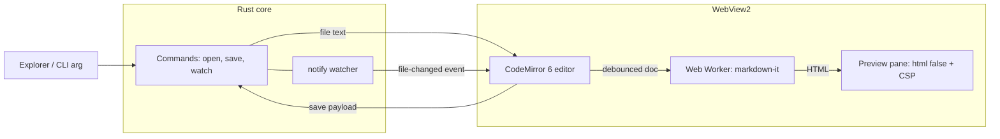

# PRD — Markdown Editor for Windows (Tauri 2 + CodeMirror 6)

Sep 26, 2026 · @Vikas Singh · performance budgets revised 29 Sep 2026

## Overview

Build a Windows-native Markdown editor that shows its window in about 150 ms, opens a typical file in under 900 ms, ships as a sub-10 MB installer and idles around 100 MB total RAM (under 80 MB when left alone), using Tauri 2 and CodeMirror 6.

**Problem.** Popular Markdown editors on Windows are either Electron apps (150–300 MB RAM, 80–150 MB installers) or bare text editors with no live preview. Opening a single README should not cost the memory of a browser.

**Vision.** A focused, keyboard-first editor: open a `.md` file, edit with syntax highlighting, see a live preview, save. Nothing else competes for resources.

**Approach.** Tauri 2 reuses the WebView2 runtime already present on Windows 10/11, so no browser engine ships in the installer. A thin Rust core owns file I/O; a lightweight TypeScript frontend hosts CodeMirror 6 for editing and markdown-it for preview.

## Goals, non-goals and success metrics

v1.0 succeeds when every performance budget below holds on a mid-range Windows 11 laptop (4-core CPU, 8 GB RAM, SSD).

**Goals**

- Fast, reliable read/edit/save of Markdown files on Windows 10 (22H2) and Windows 11.
- Live side-by-side preview that never blocks typing.
- Smallest practical install and memory footprint without sacrificing text-editing quality (IME, undo, selection, accessibility).

**Non-goals (v1)**

- WYSIWYG / block editing (Notion-style).
- Cloud sync, accounts, collaboration.
- Plugin system.
- macOS and Linux builds (the stack allows them later at low cost).

**Performance budgets**

Revised 29 Sep 2026. The first version of this table was written from assumptions (a "100 KB file", 500 ms starts, 16 ms typing) and two rows had to be walked back after measurement. These budgets are set from evidence instead:

- **What people open.** A scan of the 737 `.md` files on a developer / AI-agent workstation (dependency and build folders excluded; one machine, so treat it as indicative): median 5.9 KB, 90th percentile 22 KB, 95th 31 KB, 99th 54 KB; 98.8% are under 50 KB and only one file exceeds 100 KB (a 484 KB cached changelog). Most contain YAML frontmatter and a few fenced code blocks. Budgets are therefore measured on a **typical document**, `scripts/fixtures/typical.md` (5 KB: frontmatter, `bash` and `json` fences, a table), and checked against real 95th-percentile files (30 KB).
- **What the platform costs.** WebView2's own processes use about 95 MB and about 545 ms of every cold start before any Marky code runs. Each ordinary feature adds a little more (a code-fence language +3–6 MB, YAML frontmatter +6 MB, a table +2 MB). Budgets have to sit above that floor.
- **What Windows does.** An untouched process has its working set trimmed by Windows, so RAM is quoted in use (10 s after launch) and after the idle trim described below.

| Metric | Target | Hard limit | How measured |
| --- | --- | --- | --- |
| Installer size (NSIS .exe) | ≤ 6 MB | 10 MB | CI artifact size |
| App binary (.exe) | ≤ 8 MB | 12 MB | CI artifact size |
| Window visible in the theme's colour (no white flash) | ≤ 300 ms | 500 ms | `scripts/bench-flash.ps1`, pixel probe; white time must be 0 ms |
| Cold start to editable, typical document | ≤ 900 ms | 1,000 ms | `scripts/bench.ps1`: process start to first CodeMirror paint |
| Open 1 MB file | ≤ 150 ms | 300 ms | `scripts/bench-large.ps1`: IPC ready to file loaded |
| Typing latency, input event to next painted frame (p50) | ≤ 20 ms | 33 ms | `scripts/bench-large.ts measure`; includes one 60 Hz frame, so 16 ms is the floor, not a target |
| Preview update after typing stops | ≤ 200 ms | 400 ms | Same harness; includes the typing pause (30–150 ms, scaled to parse time) |
| Idle RAM in use, typical document | ≤ 105 MB | 120 MB | `scripts/bench.ps1`: app + WebView2 child processes, 10 s after launch |
| Idle RAM in use, 95th-percentile document (30 KB) | ≤ 120 MB | 135 MB | Same, on a real 30 KB file |
| Idle RAM after 30 s with no input | ≤ 85 MB | 100 MB | `scripts/bench.ps1`, 42 s after launch (memory trimmed while idle) |
| Idle CPU | 0% | < 0.5% | Task Manager over 60 s |
| First keystroke after an idle trim | ≤ 60 ms | 100 ms | Real key press after 40 s idle |

**Large documents are held to "stays usable", not to a memory budget.** Files up to 1 MB must keep typing latency ≤ 33 ms (p95) and never stall the main thread for more than 150 ms; the preview turns itself off above 5 MB, and the editor stays responsive at 8 MB and beyond. Memory grows about 0.4 MB per KB of document while the preview is on, and that is accepted because files over 100 KB are rare (see above). Windowed preview rendering (draw only the blocks near the viewport) would fix it and is deliberately not built; revisit if real usage shows large files matter.

RAM is measured across all WebView2 helper processes, not just the main process, so the number stays honest against Electron comparisons.

**Idle trimming.** After 30 seconds without input, and while the window is minimised, Marky asks WebView2 to trim its memory (`MemoryUsageTargetLevel`, Microsoft's guidance for inactive webviews). A typical document drops from about 100 MB to about 77 MB, and the first keystroke after coming back costs about 5 ms extra. Hovering does not count as activity; keys, clicks, scrolling, menu commands and files changing on disk do. Not on focus loss, so Alt+Tab back into the editor stays instant.

**History of the revised rows.** The M0 baseline (27 Sep 2026, i5-9300H, 16 GB) measured installer 1.68 MB, exe 3.75 MB, idle RAM 97.5 MB and cold start 891 ms, with about 610 ms of cold start being WebView2 creating its browser process, so the cold-start budget was revised from 400 / 700 ms to 800 / 1,000 ms. On 28 Sep the RAM target moved from ≤ 90 MB to ≤ 105 MB for the same reason. On 29 Sep the RAM rows were re-based on typical documents, the impossible "16 ms typing" target became 20 ms, cold start became 900 ms (the best measured was 816 ms with a 545 ms platform floor), and the idle-trim and window-visible rows were added. Current numbers live in the README's Benchmarks section.

## Target users and use cases

Primary users are developers and technical writers who live in Markdown and want it to open as fast as Notepad.

| Persona | Core use case | What they care about |
| --- | --- | --- |
| Developer | Edit READMEs, CHANGELOGs, ADRs, docs in repos | Instant open from Explorer, GFM, code-block highlighting |
| Technical writer | Long-form docs, notes, blog drafts | Distraction-free editing, word count, documents up to about 1 MB staying responsive |
| AI power user | Review and edit prompt files, agent context docs (`CLAUDE.md`, `AGENTS.md`, `SKILL.md`) | Fast open/close, external-change detection when agents rewrite files, YAML frontmatter shown properly |

The file-size data behind the budgets supports these personas: on a developer workstation the typical Markdown file is a 6 KB README, skill or instruction file, usually with frontmatter and a few code blocks; files above 100 KB are about 1 in 700.

Key scenarios: double-click a `.md` in Explorer and start typing; drag a file onto the window; edit while another tool (git, an AI agent) changes the file on disk.

## Functional requirements

The MVP (P0) is single-file open, edit, preview and save; everything else is layered on without touching the core.

| ID | Priority | Requirement | Acceptance criteria |
| --- | --- | --- | --- |
| F1 | P0 | Open file (dialog, drag-drop, CLI arg, Explorer "Open with") | `.md`, `.markdown`, `.txt` open; UTF-8 and UTF-8 BOM detected; BOM and line endings (CRLF/LF) preserved on save |
| F2 | P0 | Edit with Markdown syntax highlighting | CodeMirror 6 with `@codemirror/lang-markdown` (GFM); fenced code blocks highlighted for top 15 languages via lazy-loaded language packs |
| F3 | P0 | Save / Save As, Ctrl+S | Atomic write (temp file + rename); dirty indicator in title bar; no data loss if app is killed mid-save |
| F4 | P0 | Live preview pane | GFM (tables, task lists, strikethrough, autolinks); debounced by a typing pause scaled to parse time (30–150 ms); sanitized HTML; toggle with Ctrl+Shift+V |
| F5 | P0 | Unsaved-changes guard | Prompt on close/open-new when dirty |
| F6 | P0 | Light/dark theme following Windows setting | Switches live when OS theme changes |
| F7 | P0 | Find and replace | Ctrl+F / Ctrl+H, regex and case toggles (`@codemirror/search`) |
| F8 | P1 | External change detection | File watcher; if clean, reload silently; if dirty, show diff-free prompt (Keep mine / Reload) |
| F9 | P1 | Recent files (last 10) | Persisted in app config dir; jump list entries on taskbar |
| F10 | P1 | Synced scroll between editor and preview | Scroll position maps by source line within ±1 block |
| F11 | P1 | Status bar | Words, characters, line/column, encoding, line ending |
| F12 | P1 | Local images in preview | Relative image paths resolve against file folder via scoped asset protocol |
| F13 | P1 | Auto-save and crash recovery | Optional auto-save (off by default); unsaved buffer snapshot every 30 s to app data dir |
| F14 | P2 | Tabs / multiple files | Up to 20 open files; memory grows ≤ 3 MB per 100 KB file |
| F15 | P2 | Export to HTML and PDF | HTML via same renderer; PDF via WebView2 print-to-PDF |
| F16 | P2 | Mermaid and math (KaTeX) in preview | Lazy-loaded only when a fenced `mermaid` or `$$` block is present |
| F17 | P2 | Outline sidebar | Heading tree from the Markdown syntax tree; click to jump |
| F18 | P2 | Auto-update | Signed updates via the Tauri updater plugin |

**Keyboard-first.** Every P0/P1 action has a shortcut; standard Windows shortcuts (Ctrl+N/O/S/W/Z/Y) work as expected.

## Non-functional requirements

Performance budgets are release-blocking; the rest are v1.0 quality gates.

- **Performance:** size budgets are enforced in CI on every release build; the timing and RAM budgets are release-blocking and checked by the scripts named in the table. Files up to 1 MB stay fully responsive with the preview on; the editor stays responsive at 8 MB and beyond (CodeMirror renders only the visible viewport); files above 5 MB open with preview off by default.
- **Large-file preview:** Markdown parsing runs in a Web Worker, which renders each top-level block separately; the page replaces only the blocks an edit changed, and the panes are CSS-contained so editing never re-walks the preview.
- **Security:** strict CSP, sanitized preview, least-privilege Tauri capabilities (see Security model). No telemetry by default.
- **Accessibility:** WCAG 2.2 AA contrast in both themes; full keyboard navigation; CodeMirror screen-reader support verified with NVDA and Windows Narrator.
- **Input:** IME composition (e.g. Chinese, Japanese, Korean input methods) works without dropped characters.
- **Reliability:** atomic saves; crash-recovery snapshots; zero data loss on forced termination during save.
- **Offline:** 100% offline; no network calls except the opt-in update check.
- **Localization-ready (deferred):** v1 strings live in TypeScript, HTML and `menu.rs`; a single JSON catalogue is a later refactor. English only in v1.
- **Portability:** a portable ZIP build runs without installation (WebView2 must already be present).

## Tech stack

Tauri 2.11 on Rust stable with a vanilla-TypeScript frontend, CodeMirror 6 and markdown-it; versions below were checked against the npm registry and crates.io on 26 Sep 2026 and are pinned with caret ranges.

| Layer | Choice | Current version | Why |
| --- | --- | --- | --- |
| App shell | [tauri](https://v2.tauri.app/release/tauri/) (crate) | 2.11.6 | WebView2-based, no bundled browser |
| CLI | @tauri-apps/cli | 2.11.5 | Dev server, build, NSIS/MSI bundling |
| JS bridge | @tauri-apps/api | 2.11.1 | `invoke`, events, window APIs |
| Native dialogs | tauri-plugin-dialog | 2.7.3 | Open/Save As/confirm dialogs |
| External links | tauri-plugin-opener | 2.5.x | Opens http(s)/mailto from custom `open_external`; no shell permission on the webview |
| Single instance | tauri-plugin-single-instance | 2.4.5 | Second double-click opens file in the running window |
| Updater (P2) | tauri-plugin-updater | 2.12.0 | Signed delta-free updates (not wired in v1 beta) |
| File watching | notify (crate) | 8.2.0 | External change detection (F8) |
| Editor | @codemirror/view / state | 6.43.13 / 6.7.6 | Viewport rendering, transactions |
| Markdown mode | @codemirror/lang-markdown | 6.5.2 | GFM syntax tree, nested code highlighting |
| Code-block languages | @codemirror/language-data | 6.5.2 | Lazy-loads language packs on demand |
| Search | @codemirror/search | 6.7.2 | Find/replace panel |
| Commands | @codemirror/commands | 6.11.1 | Keymaps, history |
| Preview renderer | markdown-it | 15.0.2 | Fast, CommonMark + GFM plugins, source-line maps for synced scroll; `html: false` so raw HTML is text |
| Math (P2) | KaTeX | 0.18.9 | Lazy-loaded |
| Diagrams (P2) | Mermaid | 12.0.0 | Lazy-loaded, heavy (\~1 MB), never in the main chunk |
| Build | Vite | 8.3.1 | Fast dev, code-splitting |
| Language | TypeScript | 7.0.2 | Native compiler, fast type-checks |

**UI framework decision:** vanilla TypeScript for v1. The UI is a toolbar, two panes and a status bar; a framework adds bundle weight without value. Revisit with SolidJS (1.9.x, \~7 KB) if tabs and sidebar state grow complex.

**Note:** CodeMirror's source moved from GitHub to code.haverbeke.berlin in April 2026 ([example repo notice](https://github.com/codemirror/lang-json)); npm package names are unchanged.

**Runtime prerequisite:** Microsoft Edge WebView2 Evergreen runtime, preinstalled on Windows 11 and current Windows 10. The installer uses the bootstrapper to install it only when missing.

## Architecture

Rust owns the disk; the webview owns the text. The document lives in CodeMirror state and crosses IPC only on open, save and external change.



**IPC surface (custom commands)**

| Command / event | Direction | Payload | Notes |
| --- | --- | --- | --- |
| `open_file(path)` | JS → Rust | path | Returns text, encoding, BOM flag, line ending, mtime |
| `save_file(path, text, meta)` | JS → Rust | text + meta | Atomic write: temp file in same folder, flush, rename; returns new mtime |
| `watch_file(path)` / `unwatch_file` | JS → Rust | path | One watcher per open file; debounced 100 ms |
| `file-changed` | Rust → JS | path, mtime | Ignored when mtime matches our own last save |
| `snapshot_buffer(id, text)` | JS → Rust | text | Crash-recovery copy in `%LOCALAPPDATA%` |
| `startup-file` | Rust → JS | path | From CLI arg or single-instance forward |

**Design rules**

- **No per-keystroke IPC.** Typing never leaves the webview.
- **Preview off the main thread.** The worker receives the full text at most once per typing pause (twice the last parse time, 30–150 ms) and returns one HTML string per top-level block (with `data-line` source maps for synced scroll); the page diffs blocks and replaces only the changed ones.
- **Lazy everything.** Language packs, KaTeX and Mermaid load via dynamic `import()` only when content needs them; the initial JS bundle budget is ≤ 250 KB gzipped.
- **Config** (theme override, recent files, settings, window bounds) stored as JSON in the app config dir via plain Rust serde (`store.rs`, `window.json` for size/position/maximized).
- **Encoding:** UTF-8 only in v1; other encodings open read-only with a warning (open question below).

## Security model

Treat every Markdown file as untrusted input: a malicious file must not be able to run script, reach IPC, or read files outside what the user opened.

- **Preview sanitization:** markdown-it runs with `html: false` (raw HTML rendered as text, never executed). A future raw-HTML option would require DOMPurify before any HTML reaches the DOM (see `AGENTS.md`). Mermaid may pull DOMPurify transitively; Marky does not render user HTML today.
- **CSP** in `tauri.conf.json`: `default-src 'self'; script-src 'self'; style-src 'self' 'unsafe-inline'; img-src 'self' asset: data:; connect-src ipc: http://ipc.localhost; object-src 'none'; frame-src 'none'`.
- **Capabilities (least privilege):** the main window webview gets only `core:event` and `core:window:allow-set-title` (`capabilities/default.json`). Dialogs, file I/O and link opening run in Rust via plugins and custom commands, not as webview permissions.
- **File scope:** custom commands only touch paths the user selected (dialog, drag-drop, CLI arg); the asset protocol scope for preview images is widened at runtime to the open file's folder only.
- **Links:** clicks on `http(s)` links in preview are intercepted and opened in the default browser via tauri-plugin-opener; the webview never navigates away.
- **Updates:** updater artifacts signed with the Tauri minisign key; the private key lives only in CI secrets.
- **Supply chain:** lockfiles committed; `cargo audit` and `npm audit` gate every CI build; Dependabot weekly PRs (`.github/dependabot.yml`).

## Build, packaging and distribution

Ship an NSIS installer plus a portable ZIP from GitHub Actions on `windows-latest`; code signing is the one decision still open because Azure Artifact Signing does not cover India-based developers.

**Size-optimised release profile** (`src-tauri/Cargo.toml`):

```toml
[profile.release]
opt-level = "s"
lto = true
codegen-units = 1
panic = "abort"
strip = true
```

**Bundles**

- **NSIS `.exe`** (primary): per-user install, no admin prompt; WebView2 `downloadBootstrapper` mode keeps the installer small.
- **Portable ZIP:** the bare `.exe` for users who already have WebView2.
- **File associations** for `.md` and `.markdown` declared in `tauri.conf.json` (`bundle.fileAssociations`), registered as "Open with" rather than forced default.
- **winget manifest** submitted on each stable release.

**CI pipeline (GitHub Actions)**

1. Lint and type-check (TypeScript, `cargo clippy -D warnings`).
2. Unit tests: Rust (`cargo test`) for file I/O and encoding; Vitest for render pipeline.
3. E2E smoke tests via `tauri-driver` (WebDriver): open, edit, save, reopen, compare bytes.
4. `cargo audit` + `npm audit --omit=dev`.
5. `tauri build`, sign, then fail the job if installer > 10 MB or `.exe` > 12 MB.
6. Publish GitHub Release with updater JSON (P2).

**Code signing options**

| Option | Cost | Fits an India-based individual? | Notes |
| --- | --- | --- | --- |
| [Azure Artifact Signing](https://learn.microsoft.com/en-us/azure/artifact-signing/quickstart) | $9.99/month (Basic, 5,000 signatures) | No | Public Trust individuals must be in the US or Canada |
| OV code-signing cert with cloud HSM (e.g. SSL.com eSigner, Certum) | Paid yearly; verify current price | Yes | CA/B Forum caps validity at 460 days from 1 Mar 2026 ([source](https://www.devclass.com/security/2026/01/14/code-signing-windows-apps-may-be-easier-and-more-secure-with-new-azure-artifact-service/4079554)); cloud HSM works in CI |
| Microsoft Store (MSIX) | Verify current registration fee | Yes | Store signs the package; needs extra MSIX packaging step outside Tauri's bundler |
| Unsigned | Free | Yes | SmartScreen warning on first runs; acceptable only for an early beta |

## Milestones

MVP in 3 weeks and v1.0 in 7 weeks, assuming one developer part-time (\~20 h/week); start dates are relative until a kickoff date is set.

| Milestone | Week | Scope | Exit gate |
| --- | --- | --- | --- |
| M0 Spike | 1 | Scaffold, CodeMirror + preview worker, measure baseline RAM/start time | Idle RAM ≤ 120 MB, cold start ≤ 1,000 ms on test laptop |
| M1 MVP | 2–3 | F1–F7 (open, edit, save, preview, guard, theme, find) | All P0 acceptance criteria pass; atomic-save kill test passes |
| M2 Beta | 4–5 | F8–F13, CSP + capabilities hardened, NSIS + portable builds, CI budgets enforced | 10 beta users for 1 week, zero data-loss reports |
| M3 v1.0 | 6–7 | Signing, winget, accessibility and IME pass, docs | All budgets met at target (not hard limit); signed installer published |
| M4 v1.x | 8+ | P2: tabs, export, Mermaid/KaTeX, outline, auto-update | Per-feature, without breaching budgets |

**M2 status (27 Sep 2026):** F8, F10, F11, F12, F13 crash recovery, and F9's recent list (Ctrl+R) are done; CI, size budgets and the portable ZIP are in `.github/workflows/ci.yml`. Deferred: F9 taskbar jump-list entries (need Win32 code outside Tauri's API). Synced scroll is one-way (editor drives preview).

**M3 status (27 Sep 2026):** WCAG AA contrast is verified by script in both themes; keyboard and screen-reader fixes are in (focusable preview, no live-region spam, listbox semantics); IME composition is covered by the end-to-end test. Signing is wired route-agnostically (`scripts/build-signed.ps1`, CI secret `MARKY_SIGN_COMMAND`) and the winget manifest generator is validated; both wait on the signing decision and a first public release. The exit gate 'all budgets at target' was not met at the time (cold start about 940 ms against a target of 800, idle RAM about 103 MB against 90); both targets were set from assumptions and are re-based below. Manual NVDA and Narrator passes are still to do.

**Performance pass (28–29 Sep 2026):** cold start 924 → about 850–900 ms (network service in-process, Markdown without the JavaScript and CSS parsers in the startup bundle, initial JS 229 → 175 KB gzipped); no more white flash at launch (the window is created in code with the theme's colour: 630–730 ms of white → 0 ms); the preview updates by block and the panes are CSS-contained (a 1 MB file: longest freeze 901 → about 100 ms, typing 30 → 18 ms; 4 MB typing 67 → 19 ms); idle trimming (about 100 → 77 MB after 30 s without input). The budgets were then re-based on how Markdown is actually used (see Performance budgets). Measured against the revised table, every row is met on the typical document; the cold-start row is the tightest (about 850–900 ms against 900). Benchmarks now run on `scripts/fixtures/typical.md` and the harnesses clean up their own crash snapshots: an 8.5 MB leftover `recovery.json` had been inflating cold start by about 150 ms and RAM by 20+ MB in earlier runs.

**F14 status (27 Sep 2026):** tabs shipped early with a native menu bar and multi-file drag and drop. Measured memory growth is 2.5 MB per extra 100 KB tab (budget 3 MB).

**F16/F17 status (27 Sep 2026):** Mermaid (lazy, strict security, cached), KaTeX math (worker-rendered, lazy CSS and fonts) and the outline sidebar shipped. The installer is 4.46 MB with both.

**Settings (28 Sep 2026):** a settings panel (gear, Ctrl+,) covers theme, font size, word wrap, auto-save (completing F13, off by default), the line ending for new files, and preview and outline visibility.

## Risks and open questions

The biggest risk is WebView2 memory creeping past the 120 MB limit as features are added: a typical document sits at about 100 MB against a ~95 MB platform floor, so each new feature that loads code or DOM eats into a thin margin. Measure with `scripts/bench.ps1` on the typical fixture before and after any feature.

| Risk | Likelihood | Impact | Mitigation |
| --- | --- | --- | --- |
| WebView2 helper processes push RAM over budget | Medium | High | Measured in M0 and on every performance pass; unused browser features disabled via WebView2 args; network service in-process; memory trimmed after 30 s idle and while minimised; lazy-load everything |
| Preview jank or RAM growth on large files | Low (files over 100 KB are about 1 in 700) | Medium | Worker-based parsing, block-level preview updates, CSS containment, preview auto-off above 5 MB; windowed rendering held back until usage justifies it |
| Benchmarks fooled by leftovers or by Windows | Medium | Medium | Harnesses delete their own crash snapshots; RAM is reported in use and after the idle trim; compare runs only within one session (machine background load moves typing latency by up to 2×) |
| XSS via crafted Markdown reaching IPC | Low | High | `html: false`, strict CSP, minimal capabilities, no webview navigation |
| Save corruption on crash or power loss | Low | High | Temp-file + flush + atomic rename; crash snapshots |
| SmartScreen warnings hurt adoption | High (unsigned) | Medium | Decide signing route before v1.0 (see table in Build section) |
| Mermaid bundle bloat | High if eager | Medium | Dynamic import only when a `mermaid` block exists |
| CodeMirror source moved off GitHub | Low | Low | npm packages unchanged; track changelogs on codemirror.net |

**Open questions**

- [x] Code signing: unsigned beta first (decided 27 Sep 2026). SmartScreen warnings are accepted for the beta; the signing hook stays wired so a certificate can be added before v1.0 without code changes.
- [ ] Support non-UTF-8 encodings (UTF-16, Windows-1252) in v1, or read-only warning only?
- [ ] Should raw HTML in Markdown render (sanitized) by default, or stay off?
- [x] Open source under the MIT license (decided 27 Sep 2026).
- [ ] Is an ARM64 Windows build needed for v1.0?
- [x] Idle RAM target revised from ≤ 90 MB to ≤ 105 MB, hard limit 120 MB unchanged (decided 28 Sep 2026). WebView2's own processes use about 95 MB on the test laptop, so 90 MB was out of reach for any WebView2 app. Re-based on a typical document on 29 Sep (see below).
- [x] Cold-start budget revised to ≤ 800 ms target / 1,000 ms hard limit after M0 measured a ~610 ms WebView2 floor; on 29 Sep the target became ≤ 900 ms (best measured 816 ms, platform floor about 545 ms).
- [x] Budgets re-based on evidence instead of assumption (decided 29 Sep 2026): measured on a typical document (median file 5.9 KB, 95th percentile 31 KB) instead of a "100 KB file"; typing target 20 ms because 16 ms is one 60 Hz frame; large files held to "stays usable" rather than a memory budget.
- [x] Idle memory trimming adopted (decided 29 Sep 2026): after 30 s without input, and while minimised, at the cost of about 5 ms on the first keystroke afterwards.
- [ ] Windowed preview rendering for large files: not built. The first render still creates the whole preview DOM (about 0.4 MB per KB of document). Revisit only if usage data shows files over 100 KB matter.

## Sources

- Markdown file-size scan, 29 Sep 2026: 737 files under the user's Projects, Documents, Desktop, Downloads and `.claude` folders of one developer workstation, dependency and build folders excluded, sizes only (the source of the budget evidence above; repeat it on other machines before treating it as general)
- [Tauri ecosystem releases](https://v2.tauri.app/release/) (core 2.11.x, plugins)
- npm registry and crates.io, queried 26 Sep 2026, for all version numbers in the Tech stack table
- [Artifact Signing quickstart — Microsoft Learn](https://learn.microsoft.com/en-us/azure/artifact-signing/quickstart) (eligibility)
- [Artifact Signing SKU and pricing — Microsoft docs](https://github.com/MicrosoftDocs/azure-docs/blob/main/articles/artifact-signing/how-to-change-sku.md)
- [DevClass: Azure Artifact Signing GA and CA/B Forum 460-day rule](https://www.devclass.com/security/2026/01/14/code-signing-windows-apps-may-be-easier-and-more-secure-with-new-azure-artifact-service/4079554)
- [CodeMirror repository move notice](https://github.com/codemirror/lang-json)
